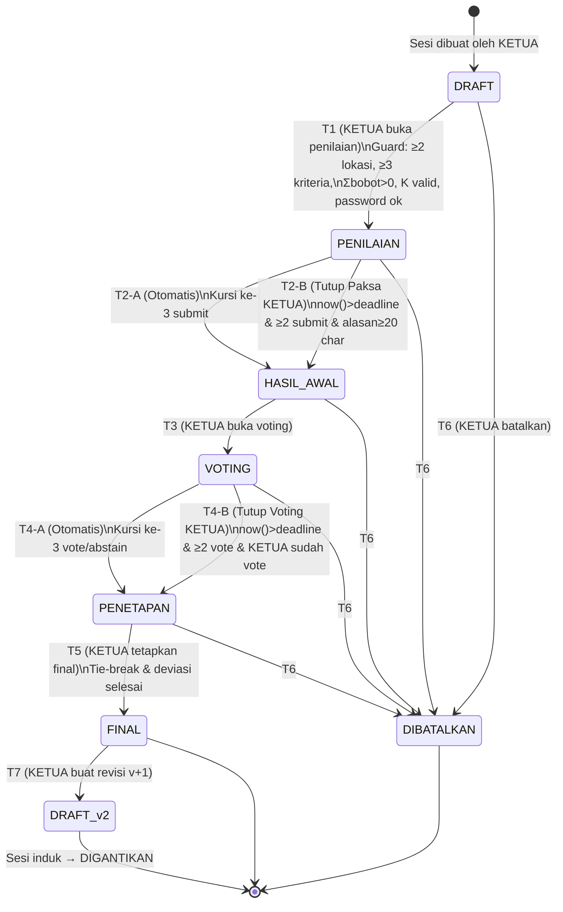
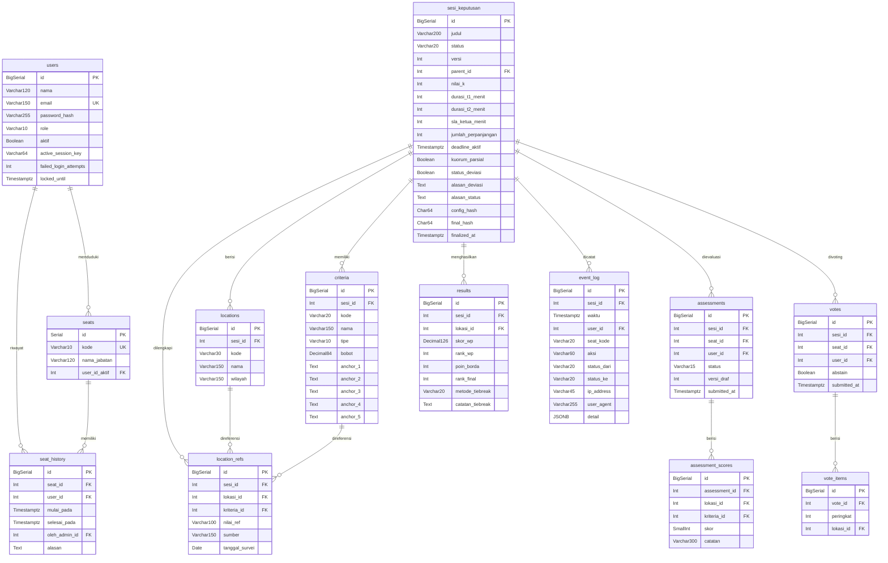
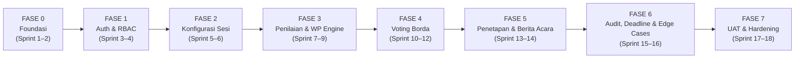

# 📋 Analisis PRD & Rancangan Pengembangan
## GDSS — Sistem Pendukung Keputusan Kelompok Pascabencana

> **Dokumen Sumber:** PRD GDSS.docx  
> **Tanggal Analisis:** 18 November 2026  
> **Versi PRD:** 1.0 (Initial)

---

## BAGIAN 1 — ANALISIS MENDALAM PRD

### 1.1 Ringkasan Eksekutif Sistem

Sistem ini adalah **aplikasi web monolit** berbasis GDSS (Group Decision Support System) yang dirancang khusus untuk mendukung proses penentuan lokasi prioritas rekonstruksi dan alokasi bantuan pascabencana secara **objektif, terukur, transparan, dan dapat diaudit**.

**Kata kunci arsitektur:** _Human-in-the-Loop_ — sistem **membantu** keputusan, bukan **menggantikan** manusia.

---

### 1.2 Aktor & Model Kursi (Seat-Based)

Sistem menggunakan **model kursi jabatan tetap**, bukan model akun biasa. Hak akses melekat pada **kursi**, bukan pada individu.

| Kursi | Kode | Peran | Hak Khusus |
|-------|------|-------|------------|
| Ketua Pelaksana BPBD | `KETUA` | Decision Maker (DM) + Pemimpin Sesi | Konfigurasi sesi, buka/tutup tahap, tie-break manual, tetapkan final |
| Kepala Dinas PU | `PU` | Decision Maker (Teknis) | Penilaian & voting saja |
| Kepala Dinas Sosial | `SOSIAL` | Decision Maker (Kemanusiaan) | Penilaian & voting saja |
| Administrator Teknis | `ADMIN` | Operator (Non-DM) | Kelola akun, tukar Plt, pantau log — **dilarang menilai/voting** |

> [!IMPORTANT]
> **Tepat 3 kursi DM + 1 ADMIN** — tidak boleh ditambah, dikurangi, atau diubah. Ini adalah **Zona 2 No-Vibe** yang tidak boleh dimodifikasi sama sekali.

---

### 1.3 Delapan "No-Vibe Zones" — Logika Bisnis yang Dikunci

Ini adalah zona-zona yang **sama sekali tidak boleh diubah** selama pengembangan:

| Zona | Aturan Mutlak |
|------|---------------|
| **Z1** | Tidak ada cron/timer yang otomatis mengubah status ke `FINAL` |
| **Z2** | Tepat 3 kursi DM (KETUA, PU, SOSIAL) + 1 ADMIN — tidak dinamis |
| **Z3** | Agregasi = **rata-rata geometrik**; perankingan = **Weighted Product (WP)** — dilarang SAW/TOPSIS/rata-rata aritmetika |
| **Z4** | Tahap voting dengan **Borda Top-K** wajib selalu ada (tidak bisa dilewati) |
| **Z5** | **Blind scoring** — skor mentah DM lain tidak boleh bocor sebelum `FINAL` |
| **Z6** | Setelah `FINAL`, seluruh data **immutable**; `event_log` tidak punya `UPDATE`/`DELETE` |
| **Z7** | Identitas kursi/peran dibaca dari `request.user` di server, **bukan** dari URL/form/query string |
| **Z8** | Output alokasi bantuan = **daftar Top-K lokasi prioritas** saja — tidak ada modul gudang/anggaran |

---

### 1.4 State Machine Sesi — 8 Status Deterministik



> [!CAUTION]
> **Zona 1:** Tidak ada satupun panah dari status apapun ke `FINAL` yang dilakukan **otomatis oleh sistem**. T5 selalu memerlukan aksi eksplisit KETUA.

---

### 1.5 Logika Matematis Inti (Dikunci — Zona 3)

#### A. Normalisasi Bobot

$$\hat{w}_j = \frac{W_j}{\sum_{k=1}^{c} W_k}$$

sehingga $\sum_{j=1}^{c} \hat{w}_j = 1$

#### B. Agregasi Kelompok — Rata-Rata Geometrik

Untuk lokasi $i$, kriteria $j$, dari himpunan kursi yang submit $S$ (|S| ≥ 2):

$$\bar{x}_{i,j} = \left(\prod_{d \in S} x_{i,j}^{(d)}\right)^{1/|S|}$$

> [!NOTE]
> Karena domain skor $x \in [1, 5]$, nilai $\bar{x}_{i,j} \geq 1$ selalu, sehingga operasi pangkat negatif pada kriteria COST tidak pernah menghasilkan division-by-zero.

#### C. Vektor Preferensi Weighted Product (WP)

$$V(i) = \prod_{j=1}^{c} \bar{x}_{i,j}^{p_j}$$

$$p_j = \begin{cases} +\hat{w}_j & \text{jika BENEFIT} \\ -\hat{w}_j & \text{jika COST} \end{cases}$$

#### D. Poin Borda Top-K

$$\text{Poin}_d(i) = \begin{cases} K - r + 1 & \text{jika lokasi } i \text{ di peringkat } r \in [1,K] \\ 0 & \text{jika tidak masuk Top-K} \end{cases}$$

Total: $B(i) = \sum_{d \in S_{vote}} \text{Poin}_d(i)$

#### E. Hierarki Tie-Breaker (3 Tingkat Deterministik)

```
Poin Borda sama?
  ├─ Tingkat 1 (WP_SCORE): V(i) lebih tinggi → menang
  │   └─ V(i) sama?
  │       ├─ Tingkat 2 (KETUA_BALLOT): Peringkat di surat suara KETUA lebih tinggi → menang
  │       │   └─ KETUA tidak mencantumkan keduanya?
  │       │       └─ Tingkat 3 (KETUA_MANUAL): Tombol [Tetapkan Final] DIBLOKIR
  │       │           KETUA pilih manual + justifikasi ≥20 char
```

---

### 1.6 Matriks 8 Kriteria Baku (Seed Data — Zona Terkunci)

| Kode | Kriteria | Perspektif | Tipe | Bobot (W) |
|------|----------|------------|------|-----------|
| C1 | Tingkat kerusakan bangunan & infrastruktur | PU | BENEFIT | 15 |
| C2 | Tingkat keterisolasian akses jalan | PU | BENEFIT | 10 |
| C3 | Estimasi biaya perbaikan | PU | **COST** | 10 |
| C4 | Jumlah korban jiwa/luka | SOSIAL | BENEFIT | 15 |
| C5 | Jumlah pengungsi | SOSIAL | BENEFIT | 15 |
| C6 | Proporsi kelompok rentan (lansia, anak) | SOSIAL | BENEFIT | 10 |
| C7 | Urgensi air bersih & pangan | SOSIAL | BENEFIT | 15 |
| C8 | Risiko bencana lanjutan & stabilitas wilayah | KETUA | BENEFIT | 10 |

**Total bobot = 100** → $\hat{w}_j = W_j / 100$

---

### 1.7 Matriks Visibilitas Data Per Status

| Data | DRAFT | PENILAIAN | HASIL_AWAL | VOTING | PENETAPAN | FINAL |
|------|-------|-----------|------------|--------|-----------|-------|
| Konfigurasi (lokasi, kriteria, bobot) | Editable | **BEKU** | BEKU | BEKU | BEKU | BEKU |
| Progres kursi (bool submit/vote) | — | Visible | Visible | Visible | Visible | Visible |
| Skor mentah DM sendiri | — | Editable | BEKU | BEKU | BEKU | BEKU |
| Skor mentah DM lain | — | **TERTUTUP** | **TERTUTUP** | **TERTUTUP** | **TERTUTUP** | Terbuka |
| Peringkat WP kelompok | — | TERTUTUP | Terbuka | Terbuka | Terbuka | Terbuka |
| Isi surat suara DM lain | — | — | — | **TERSEGEL** | **TERSEGEL** | Terbuka |
| Tally Borda & tie-break | — | — | — | TERSEGEL | Hanya KETUA | Terbuka |

---

### 1.8 Spesifikasi Layar (9 Layar)

| Kode | Nama Layar | Aktor Utama |
|------|------------|-------------|
| L1 | Login | Semua |
| L2 | Beranda Sesi | Semua |
| L3 | Konfigurasi Sesi | KETUA |
| L4 | Form Penilaian DM | KETUA, PU, SOSIAL |
| L5 | Hasil Awal & Divergensi | KETUA, PU, SOSIAL |
| L6 | Ruang Konsensus / Voting | KETUA, PU, SOSIAL |
| L7 | Penetapan Ketua | KETUA |
| L8 | Berita Acara & Jejak Audit | Semua (after FINAL) |
| L9 | Manajemen Akun & Kursi | ADMIN |

---

### 1.9 15 Acceptance Criteria (Wajib Lulus Semua)

| Kode | Deskripsi Singkat | Mekanisme Utama |
|------|-------------------|-----------------|
| AC-01 | Tie-break Borda via skor WP | WP_SCORE otomatis |
| AC-02 | Tie-break Level 2 & 3 | KETUA_BALLOT & KETUA_MANUAL |
| AC-03 | RBAC server-side default-deny | 403 pada akses ilegal PU→open-voting |
| AC-04 | Blind scoring antar-DM | 403 pada manipulasi URL untuk skor DM lain |
| AC-05 | Idempotency submit suara | Unique constraint + idempotency token |
| AC-06 | Single active session per akun | `active_session_key` overwrite |
| AC-07 | Immutability skor post-submit + unlock | Buka kunci hanya KETUA + alasan |
| AC-08 | Validasi kelengkapan matriks 1–5 | HTTP 422 + highlight sel |
| AC-09 | Tutup paksa dengan kuorum 2/3 | kuorum_parsial flag + guard 1 kursi nonaktif |
| AC-10 | Larangan tutup voting sebelum deadline | Guard `now() > deadline_aktif` |
| AC-11 | Eskalasi SLA Ketua 6 jam + tukar Plt | Banner + ADMIN assign Plt |
| AC-12 | Validasi alasan deviasi keputusan | alasan_deviasi ≥ 20 char wajib |
| AC-13 | Pemulihan draf pasca login timeout | Autosave + restore 35/48 sel |
| AC-14 | Pembekuan konfigurasi sejak PENILAIAN | 403 pada perubahan bobot/lokasi/K |
| AC-15 | Immutability FINAL + append-only log | PostgreSQL REVOKE UPDATE/DELETE |

---

## BAGIAN 2 — RANCANGAN DATABASE LENGKAP

### 2.1 Entity Relationship Diagram



---

## BAGIAN 3 — RANCANGAN ARSITEKTUR APLIKASI

### 3.1 Struktur Direktori Django (Monolith)

```
gdss_project/
├── manage.py
├── requirements.txt
├── .env
├── gdss_project/           # Project config
│   ├── settings.py
│   ├── urls.py
│   └── wsgi.py
├── apps/
│   ├── accounts/           # Auth, Users, Seats
│   │   ├── models.py       # User, Seat, SeatHistory
│   │   ├── views.py        # Login, Logout, Admin panel
│   │   ├── forms.py
│   │   └── middleware.py   # SingleSessionMiddleware
│   ├── sessions/           # Sesi Keputusan (inti)
│   │   ├── models.py       # SesiKeputusan, Location, Criteria, ...
│   │   ├── views/
│   │   │   ├── config.py   # L3 — Konfigurasi
│   │   │   ├── assessment.py # L4 — Penilaian
│   │   │   ├── results.py  # L5 — Hasil Awal
│   │   │   ├── voting.py   # L6 — Voting
│   │   │   ├── finalize.py # L7 — Penetapan
│   │   │   └── report.py   # L8 — Berita Acara
│   │   ├── services/
│   │   │   ├── wp_engine.py      # Kalkulasi WP & geometrik
│   │   │   ├── borda_engine.py   # Kalkulasi Borda & tie-break
│   │   │   ├── transition.py     # State machine transitions
│   │   │   └── deadline.py       # Deadline evaluator
│   │   ├── management/commands/
│   │   │   └── check_deadlines.py # Cron 1 menit
│   │   ├── forms.py
│   │   └── urls.py
│   └── audit/              # Logging & event_log
│       ├── models.py       # EventLog
│       └── logger.py       # Append-only log writer
├── templates/
│   ├── base.html
│   ├── accounts/           # L1, L9
│   └── sessions/           # L2–L8
└── static/
    ├── css/tailwind.css
    └── js/
        ├── polling.js      # Short-poll 20s
        └── autosave.js     # Debounce autosave
```

### 3.2 Diagram Komponen Sistem

```mermaid
flowchart TD
    subgraph Client["Browser Client"]
        UI["Django Templates\nHTML5 + Tailwind CSS"]
        JS["Vanilla JS\n• polling.js (20s)\n• autosave.js (debounce 2s)"]
    end

    subgraph Django["Django Application Server"]
        MW["Middleware Stack\n• CSRF\n• SingleSession\n• RateLimit Login"]
        VIEWS["Views Layer\n• accounts/\n• sessions/\n• audit/"]
        SVC["Services Layer\n• wp_engine.py\n• borda_engine.py\n• transition.py\n• deadline.py"]
        MGMT["Management Command\npython manage.py check_deadlines\n(cron setiap 1 menit)"]
    end

    subgraph DB["PostgreSQL 15+"]
        TABLES["Tables:\n• users, seats, seat_history\n• sesi_keputusan\n• locations, criteria\n• assessments, assessment_scores\n• votes, vote_items\n• results\n• event_log (APPEND-ONLY)"]
    end

    UI -->|HTTP Request + CSRF| MW
    JS -->|fetch() polling / autosave| MW
    MW --> VIEWS
    VIEWS --> SVC
    SVC --> TABLES
    MGMT -->|Evaluasi tenggat| SVC
    VIEWS -->|HTML Response / 302 Redirect| UI
```

---

## BAGIAN 4 — RANCANGAN ALUR PENGEMBANGAN (DEVELOPMENT PLAN)

### 4.1 Prinsip Pengembangan

1. **TDD terlebih dahulu** untuk seluruh service layer (wp_engine, borda_engine, transition)
2. **Server-side enforcement first** — jangan andalkan validasi frontend
3. **Seed data wajib** sebelum testing apapun
4. **AC test** ditulis sebelum implementasi fitur terkait

---

### 4.2 Fase & Sprint Pengembangan



---

### 4.3 Detail Tiap Fase

#### ☐ FASE 0 — Fondasi Proyek (Sprint 1–2)

**Tujuan:** Setup environment, database, struktur aplikasi, seed data

**Task List:**
- [ ] `django-admin startproject gdss_project`
- [ ] Buat 3 apps: `accounts`, `sessions`, `audit`
- [ ] Konfigurasi `settings.py`:
  - `DATABASES` → PostgreSQL 15
  - `PASSWORD_HASHERS` → `Argon2PasswordHasher` (prioritas) + `BCryptPasswordHasher`
  - `TIME_ZONE = 'Asia/Jakarta'`
  - `USE_TZ = True`
  - `SESSION_ENGINE = 'django.contrib.sessions.backends.db'`
- [ ] Install & konfigurasi Tailwind CSS (via `django-tailwind` atau CDN)
- [ ] Buat seluruh **model database** sesuai spec ERD (11 tabel)
- [ ] Jalankan migrations awal
- [ ] **Konfigurasi PostgreSQL RBAC:**
  ```sql
  REVOKE UPDATE, DELETE ON event_log FROM app_user;
  GRANT SELECT, INSERT ON event_log TO app_user;
  ```
- [ ] Buat management command `seed_gdss`:
  - 4 akun: ketua@bpbd.go.id, kadis.pu@pupr.go.id, kadis.sosial@dinsos.go.id, admin@bpbd.go.id
  - 3 baris seats: KETUA, PU, SOSIAL
  - 1 sesi DRAFT dengan 6 lokasi contoh
  - 8 kriteria baku C1–C8 dengan bobot dan rubrik anchor lengkap
- [ ] Setup `pytest-django` dan struktur test
- [ ] Buat `base.html` template dengan layout responsif (mobile 360px → desktop 1440px)

**Deliverable:** `python manage.py migrate && python manage.py seed_gdss` berjalan tanpa error

---

#### ☐ FASE 1 — Autentikasi & RBAC (Sprint 3–4)

**Tujuan:** L1 (Login), middleware keamanan, single-session enforcement

**Task List:**
- [ ] **Model `User`** (extend `AbstractBaseUser`):
  - `active_session_key` (Varchar 64, nullable)
  - `failed_login_attempts` (Int, default 0)
  - `locked_until` (Timestamptz, nullable)
  - `role` (DM | ADMIN)
- [ ] **Login view** dengan:
  - Rate-limiting: 5 gagal → kunci 15 menit (cek `locked_until`)
  - Single-session enforcement: generate `active_session_key` baru → invalidasi sesi lama
  - Redirect ke L2 setelah sukses
  - Redirect ke L1 dengan pesan jika sesi diputus
- [ ] **Middleware `SingleSessionMiddleware`**: tiap request, cocokkan `request.session['session_key']` dengan `users.active_session_key` di DB → jika tidak cocok, logout paksa
- [ ] **Logout view**: hapus `active_session_key`
- [ ] **Decorator/mixin `RBACMixin`**: validasi `request.user.role` dan relasi `seats` untuk setiap view yang memerlukan otorisasi — semua unauthorized → 403 + catat `event_log`
- [ ] **L1 Template**: form login, spinner loading, 3 jenis pesan error
- [ ] **Test suite (pytest):**
  - `test_login_rate_limit` (5 gagal → kunci)
  - `test_single_session_enforcement` (login B → sesi A diputus)
  - `test_rbac_default_deny` (akses view tanpa otorisasi → 403)

**Deliverable:** AC-03 & AC-06 lulus

---

#### ☐ FASE 2 — Konfigurasi Sesi & Beranda (Sprint 5–6)

**Tujuan:** L2 (Beranda Sesi), L3 (Konfigurasi), Transisi T1

**Task List:**
- [ ] **Model `SesiKeputusan`** dengan semua field (status, versi, parent_id, nilai_k, durasi, deadline, hash, dll.)
- [ ] **L2 — Beranda Sesi**:
  - Badge status sesi
  - Kotak "Tugas Anda Saat Ini" (kontekstual per peran & status)
  - Kartu progres 3 kursi (hanya boolean, tanpa nilai)
  - Hitung mundur tenggat
  - Short-polling JS: `fetch('/api/sessions/{id}/status/')` setiap 20 detik
  - Banner merah eskalasi
- [ ] **L3 — Konfigurasi Sesi**:
  - Form metadata sesi (judul, nilai_K default=3, durasi T1 default=1440 menit, durasi T2 default=720 menit)
  - Tabel dinamis lokasi (tambah/hapus baris, min. 2)
  - Tabel kriteria C1–C8 (pre-filled dari seed, editable bobot)
  - Panel data pendukung (`location_refs`) — opsional
- [ ] **Endpoint `GET/POST /api/sessions/{id}/status/`**:
  - Filter payload sesuai Matriks Visibilitas (Sub-bab 4.3)
  - Lazy deadline check
- [ ] **Endpoint `POST /sessions/{id}/config/`** (simpan konfigurasi, guard: status == DRAFT)
- [ ] **Transisi T1 (`POST /sessions/{id}/open-assessment/`)**:
  - Guard: ≥2 lokasi, ≥3 kriteria, Σbobot > 0, K ∈ [1, m], konfirmasi password
  - Efek: bekukan lokasi/kriteria/bobot, hitung `config_hash` SHA-256, set `deadline_aktif`, catat log `STATE_T1`
- [ ] **Dialog konfirmasi kritis** (modal + input password) untuk T1
- [ ] **Test suite:**
  - `test_t1_guard_min_locations` (< 2 lokasi → gagal)
  - `test_t1_guard_weight_sum` (Σbobot = 0 → gagal)
  - `test_config_frozen_after_t1` → AC-14

**Deliverable:** AC-14 lulus; sesi bisa dibuat dan dibuka penilaian

---

#### ☐ FASE 3 — Penilaian DM & WP Engine (Sprint 7–9)

**Tujuan:** L4 (Form Penilaian), autosave, submit, komputasi WP, L5 (Hasil Awal), Transisi T2

**Sprint 7 — Form Penilaian (L4):**
- [ ] **Model `Assessment` + `AssessmentScore`**:
  - `versi_draf` untuk optimistic locking
  - Constraint: `skor BETWEEN 1 AND 5`
  - Unique: `(sesi_id, seat_id)`
- [ ] **L4 Template** (matriks interaktif):
  - Grid lokasi × kriteria (input integer 1–5)
  - Sticky left column (nama lokasi) untuk scroll horizontal
  - Panel rubrik anchor per kriteria (collapsible sidebar/modal)
  - Panel data referensi lapangan (dari `location_refs`)
  - Indikator autosave "Tersimpan otomatis pukul HH:MM"
- [ ] **Autosave endpoint `POST /api/sessions/{id}/assessments/draft/`**:
  - Guard: `status == PENILAIAN`, assessment masih `DRAFT`, `versi_draf` cocok
  - Debounce 2 detik di frontend (JS)
  - Return: `versi_draf + 1`, timestamp WIB
  - Jika `versi_draf` tidak cocok → HTTP 409 Conflict
- [ ] **Blind scoring enforcement**: endpoint draft/submit tidak boleh expose skor DM lain dalam respons

**Sprint 8 — Submit & WP Engine:**
- [ ] **Submit endpoint `POST /sessions/{id}/assessments/submit/`**:
  - Guard: semua sel terisi, skor ∈ [1,5], idempotency token valid, password konfirmasi
  - Jika 3/3 kursi submit → jalankan otomatis WP + transisi T2-A
- [ ] **`services/wp_engine.py`**:
  ```python
  def compute_geometric_mean(scores: list[dict]) -> dict:
      """Rata-rata geometrik antar kursi yang submit"""
  
  def normalize_weights(weights: dict) -> dict:
      """ŵ_j = W_j / ΣW_k"""
  
  def compute_wp_vector(group_scores: dict, norm_weights: dict, criteria_types: dict) -> dict:
      """V(i) = Π x̄_{i,j}^{p_j}"""
  
  def rank_wp(wp_scores: dict) -> list:
      """Sort descending, tie-break by ID"""
  ```
- [ ] **Transisi T2-A** (otomatis setelah kursi ke-3 submit):
  - Hitung rata-rata geometrik, skor WP, label divergensi
  - Simpan snapshot ke tabel `results`
  - Set `kuorum_parsial = False`
- [ ] **Transisi T2-B** (Tutup Paksa, endpoint `POST /sessions/{id}/close-assessment/`):
  - Guard: `now() > deadline_aktif`, ≥2 kursi submit, alasan ≥20 char, password valid
  - Guard negatif: jika hanya 1 kursi submit → 403, tombol nonaktif
  - Set `kuorum_parsial = True`
- [ ] **Buka Kunci Penilaian** (`POST /sessions/{id}/assessments/{seat}/unlock/`):
  - Guard: status PENILAIAN, alasan ≥20 char (hanya KETUA)
  - Set assessment kursi target → DRAFT, tampilkan banner ke akun bersangkutan

**Sprint 9 — Hasil Awal (L5) & Divergensi:**
- [ ] **Klasifikasi divergensi**:
  - Rendah: semua DM Top-1 sama
  - Sedang: 2 DM Top-1 sama, 1 berbeda
  - Tinggi: 3 DM Top-1 berbeda semua
- [ ] **L5 Template**:
  - Badge divergensi (Rendah/Sedang/Tinggi)
  - Tabel peringkat kelompok (V(i) + rank_wp)
  - Kartu per kursi: hanya urutan peringkat, **tanpa skor mentah**
  - Tombol "Buka Sesi Voting" (hanya KETUA)
- [ ] **Peringkat individual DM** dihitung dengan WP per kursi (skor mentah sendiri saja)
- [ ] **Test suite:**
  - `test_wp_calculation` (worked example dari Sub-bab 3.5) → unit test deterministik
  - `test_geometric_mean_precision`
  - `test_blind_scoring_before_final` → AC-04
  - `test_autosave_optimistic_locking` → AC-13
  - `test_matrix_validation_1_5` → AC-08
  - `test_force_close_quorum_2_3` → AC-09
  - `test_assessment_immutable_after_submit` → AC-07

**Deliverable:** AC-04, AC-07, AC-08, AC-09, AC-13 lulus

---

#### ☐ FASE 4 — Voting Borda & Tie-Breaker (Sprint 10–12)

**Tujuan:** L6 (Voting), Borda Engine, L7 awal (Tie-break), Transisi T3 & T4

**Sprint 10 — Voting Interface (L6):**
- [ ] **Transisi T3** (`POST /sessions/{id}/open-voting/`):
  - Guard: `status == HASIL_AWAL` (hanya KETUA)
  - Set `deadline_aktif = now() + durasi_t2_menit`
  - Buka formulir voting untuk semua kursi
- [ ] **L6 Template (Ruang Konsensus)**:
  - Daftar kandidat lokasi
  - Selector urutan peringkat 1 s.d. K (dropdown/drag-drop)
  - Formulir **kosong** saat pertama dibuka (cegah default bias)
  - Tombol bantu "Gunakan Urutan Rekomendasi WP" (1-klik copy peringkat WP ke form)
  - Opsi eksklusif "Abstain"
  - Modal konfirmasi ringkasan pilihan + input password
- [ ] **Model `Vote` + `VoteItem`**:
  - Unique: `(sesi_id, seat_id)` di `votes`
  - Unique: `(vote_id, peringkat)` dan `(vote_id, lokasi_id)` di `vote_items`
  - Jika abstain = true: tidak ada baris di `vote_items`

**Sprint 11 — Submit Suara & Idempotency:**
- [ ] **Submit suara** (`POST /sessions/{id}/votes/`):
  - Guard: `status == VOTING`, kursi belum ada di `votes`, tepat K lokasi unik (atau abstain), idempotency token + password
  - Idempotency token: single-use, server-generated sebelum form dibuka
  - Jika 3/3 kursi vote → jalankan Borda + tie-break → transisi T4-A
- [ ] **Tutup Voting Paksa T4-B** (`POST /sessions/{id}/close-voting/`):
  - Guard: `now() > deadline_aktif`, ≥2 kursi vote, KETUA sudah vote, alasan ≥20 char, password
  - Guard negatif: `now() ≤ deadline_aktif` → 403 meski 2/3 sudah vote

**Sprint 12 — Borda Engine & Tie-Breaker:**
- [ ] **`services/borda_engine.py`**:
  ```python
  def compute_borda_scores(votes: list[Vote], K: int) -> dict:
      """Poin_d(i) = K-r+1 jika rank r ∈ [1,K]; abstain = 0 semua"""
  
  def apply_tiebreaker(tied_locations, wp_scores, ketua_ballot) -> TiebreakerResult:
      """
      Level 1: WP_SCORE — bandingkan V(i)
      Level 2: KETUA_BALLOT — urutan surat suara KETUA
      Level 3: KETUA_MANUAL — return flag NEEDS_MANUAL
      """
  ```
- [ ] **Simpan ke `results`**: `poin_borda`, `rank_final` (sementara), `metode_tiebreak`, `catatan_tiebreak`
- [ ] **Sealed ballot enforcement**: surat suara DM lain tidak boleh tersedia sebelum FINAL
- [ ] **Test suite:**
  - `test_borda_tie_resolution_wp_score` → AC-01
  - `test_borda_tie_resolution_ketua_ballot` → AC-02 (level 2)
  - `test_borda_tie_resolution_ketua_manual` → AC-02 (level 3)
  - `test_vote_idempotency_double_click` → AC-05
  - `test_no_close_voting_before_deadline` → AC-10
  - `test_worked_example_full` (Sub-bab 3.5 exact match)

**Deliverable:** AC-01, AC-02, AC-05, AC-10 lulus

---

#### ☐ FASE 5 — Penetapan Final & Berita Acara (Sprint 13–14)

**Tujuan:** L7 (Penetapan Ketua), L8 (Berita Acara), Transisi T5, T6, T7

**Sprint 13 — L7 Penetapan Ketua:**
- [ ] **L7 Template** (hanya KETUA dapat akses):
  - Tabel rekapitulasi poin Borda
  - Indikator resolusi tie-break otomatis (badge WP_SCORE / KETUA_BALLOT)
  - Form tie-break manual + justifikasi (hanya jika KETUA_MANUAL diperlukan)
  - Deteksi deviasi: bandingkan Top-K Borda vs Top-K WP
  - Banner peringatan deviasi + input alasan deviasi (wajib ≥20 char jika deviasi = true)
  - Ringkasan daftar Top-K lokasi penerima bantuan
  - Tombol "Tetapkan Keputusan Final"
- [ ] **Transisi T5** (`POST /sessions/{id}/finalize/`):
  - Guard: tie-break manual selesai jika diperlukan + alasan deviasi valid jika deviasi
  - Hitung `final_hash` SHA-256
  - Set status → FINAL, `finalized_at = now()`
  - Buka Berita Acara untuk semua peran
  - Jika ada `parent_id`: set sesi induk → DIGANTIKAN
- [ ] **Transisi T6** (`POST /sessions/{id}/cancel/`): batalkan sesi, semua data historical tetap
- [ ] **Transisi T7** (`POST /sessions/{id}/revise/`): buat sesi baru v+1 dari FINAL, copy konfigurasi

**Sprint 14 — L8 Berita Acara:**
- [ ] **L8 Template** (read-only, semua peran, hanya setelah FINAL):
  - Kop dokumen resmi
  - Metadata sesi + `final_hash`
  - Penanda kuorum parsial & deviasi
  - Tabel Top-K lokasi prioritas penerima bantuan
  - Tabel konfigurasi & bobot
  - **Matriks skor lengkap semua DM** (terbuka setelah FINAL)
  - Rincian surat suara & poin Borda (terbuka setelah FINAL)
  - Kronologi event log berstempel waktu WIB
  - Tombol "Cetak Berita Acara" (`window.print()`)
  - `@media print` CSS untuk tata letak cetak yang bersih
- [ ] **Test suite:**
  - `test_deviation_requires_reason` → AC-12
  - `test_final_immutability` → AC-15
  - `test_revision_session_v2`
  - `test_session_cancellation`

**Deliverable:** AC-12, AC-15 lulus; Berita Acara dapat dicetak

---

#### ☐ FASE 6 — Audit, Deadline & Edge Cases (Sprint 15–16)

**Tujuan:** Management command, eskalasi SLA, penukaran Plt, L9, semua edge case

**Sprint 15 — Deadline & Eskalasi:**
- [ ] **`management/commands/check_deadlines.py`** (cron 1 menit):
  - Evaluasi T1 deadline (fase PENILAIAN)
  - Evaluasi T2 deadline (fase VOTING)
  - Evaluasi SLA Ketua 6 jam (360 menit) untuk transisi yang sudah bisa dilakukan tapi KETUA tidak melakukan
  - Trigger banner eskalasi kritis (tandai di DB)
  - **Tidak mengubah status ke FINAL** (Zona 1!)
- [ ] **Lazy deadline check**: setiap HTTP request ke sesi mengevaluasi deadline secara otomatis
- [ ] **Reminder 50% dan 80%**: notifikasi dalam-aplikasi saat tenggat mencapai setengah/80% berlalu
- [ ] **Perpanjang Tenggat** (`POST /sessions/{id}/extend-deadline/`):
  - Guard: status PENILAIAN atau VOTING, `jumlah_perpanjangan < 2`, alasan ≥20 char (hanya KETUA)
  - Tambah `deadline_aktif`, log event

**Sprint 16 — Manajemen Akun & L9:**
- [ ] **L9 Template (Manajemen Akun & Kursi)** — hanya ADMIN:
  - Tabel 3 kursi tetap + pejabat aktif saat ini
  - Modal tukar pemegang kursi (Plt): input alasan/nomor surat tugas
  - Tabel riwayat penukaran kursi (`seat_history`)
  - Manajemen akun & reset password
  - Penampil event log berjalan (real-time)
- [ ] **Endpoint tukar Plt** (`POST /admin-panel/seats/{kode}/assign/`):
  - Guard: akun target aktif, tidak menduduki kursi lain, alasan terisi
  - Putus sesi login pejabat lama (clear `active_session_key`)
  - Update `seats.user_id_aktif`
  - Insert `seat_history`
  - Catat `event_log`
- [ ] **Test suite:**
  - `test_sla_escalation_6h` → AC-11
  - `test_plt_seat_swap`
  - `test_deadline_extension_max_2`
  - `test_draft_data_missing_ok` (location_refs opsional)

**Deliverable:** AC-11 lulus; L9 berfungsi penuh

---

#### ☐ FASE 7 — UAT, Hardening & Finalisasi (Sprint 17–18)

**Tujuan:** Verifikasi seluruh 15 AC, keamanan, performa, kesiapan produksi

**Sprint 17 — Full UAT:**
- [ ] Jalankan seluruh test suite: semua 15 AC harus **PASS**
- [ ] Manual testing dengan seed data: simulasi sesi penuh DRAFT → FINAL
- [ ] Test skenario edge case:
  - Login ganda (AC-06)
  - Klik ganda submit (AC-05)
  - Koneksi terputus saat autosave (AC-13)
  - Revisi pasca-FINAL (T7)
  - Penukaran Plt saat sesi berjalan (AC-11)
- [ ] Verifikasi `event_log` append-only (coba DELETE dari psql langsung → gagal)
- [ ] Verifikasi `final_hash` konsisten

**Sprint 18 — Hardening & Deployment Prep:**
- [ ] **Keamanan**:
  - HTTPS enforcement (`SECURE_SSL_REDIRECT = True`)
  - `CSRF_COOKIE_SECURE = True`, `SESSION_COOKIE_SECURE = True`
  - `SECURE_HSTS_SECONDS = 31536000`
  - Argon2 password hashing aktif
  - Rate-limiting login terbukti (5 gagal → 15 menit)
- [ ] **Performa**:
  - Index DB: `(sesi_id, seat_id)`, `(sesi_id, lokasi_id)`, `(waktu)` pada `event_log`
  - Query optimization untuk polling endpoint (N+1 check)
  - Template caching untuk Berita Acara
- [ ] **Responsivitas**:
  - Test di 360px (mobile), 768px (tablet), 1440px (desktop)
  - Sticky column L4 berfungsi di mobile
- [ ] **Dokumentasi**: README setup, cara jalankan `seed_gdss`, cara jalankan cron

**Deliverable:** Semua 15 AC lulus; aplikasi siap deploy

---

## BAGIAN 5 — MATRIKS ENDPOINT vs ACCEPTANCE CRITERIA

| Endpoint | Method | AC Terkait |
|----------|--------|-----------|
| `/auth/login/` | POST | AC-06 |
| `/api/sessions/{id}/status/` | GET | AC-04 (filter payload) |
| `/sessions/{id}/config/` | POST | AC-14 |
| `/sessions/{id}/open-assessment/` | POST | AC-14 |
| `/api/sessions/{id}/assessments/draft/` | POST | AC-07, AC-13 |
| `/sessions/{id}/assessments/submit/` | POST | AC-07, AC-08, AC-09 |
| `/sessions/{id}/assessments/{seat}/unlock/` | POST | AC-07 |
| `/sessions/{id}/close-assessment/` | POST | AC-09 |
| `/sessions/{id}/open-voting/` | POST | AC-03 |
| `/sessions/{id}/votes/` | POST | AC-05, AC-10 |
| `/sessions/{id}/close-voting/` | POST | AC-10 |
| `/sessions/{id}/finalize/` | POST | AC-01, AC-02, AC-12, AC-15 |
| `/admin-panel/seats/{kode}/assign/` | POST | AC-11 |

---

## BAGIAN 6 — TITIK RISIKO & REKOMENDASI MITIGASI

| Risiko | Dampak | Mitigasi |
|--------|--------|----------|
| **Race condition** saat 2 kursi submit bersamaan → T2-A terpicu 2x | Data duplikat di `results` | `UPDATE sesi_keputusan SET status='HASIL_AWAL' WHERE status='PENILAIAN'` → atomic + `select_for_update()` |
| **Versi draf konflik** (2 tab browser) | Data penilaian tertimpa | Optimistic locking via `versi_draf` → HTTP 409 |
| **Double-click vote** | Duplikasi poin Borda | Idempotency token + UNIQUE constraint `(sesi_id, seat_id)` di `votes` |
| **Kebocoran skor via JSON** | Blind scoring violated (Zona 5) | Filter payload di setiap endpoint polling berdasarkan status sesi + identitas kursi |
| **Cron check_deadlines** mengubah status ke FINAL | Pelanggaran Zona 1 | Cron **hanya** mencatat log & set flag banner, tidak pernah transisi ke FINAL |
| **SHA-256 `final_hash`** tidak deterministik | Audit hash tidak valid | Hash = SHA-256(canonical JSON sorted-key: semua hasil + config + log timestamps) |
| **Perpanjang tenggat > 2x** | Penyalahgunaan | `CHECK (jumlah_perpanjangan <= 2)` di DB + guard view |
| **ADMIN akses form penilaian** | Pelanggaran Zona 2 | ADMIN role = `DM=false` → semua penilaian/voting view: guard `request.user.role != 'ADMIN'` |

---

## BAGIAN 7 — CHECKLIST ANTI-DRIFT (SEBELUM SETIAP COMMIT)

Gunakan checklist ini sebelum merge setiap fitur:

```
[ ] Tidak ada cron/timer yang mengubah status → FINAL
[ ] Jumlah kursi DM tetap 3, ADMIN tidak bisa menilai/voting
[ ] Kalkulasi WP menggunakan rata-rata geometrik + WP (bukan SAW/TOPSIS)
[ ] Tahap voting selalu ada, tidak bisa dilewati
[ ] Skor mentah DM lain tidak bocor sebelum status FINAL
[ ] event_log tidak memiliki UPDATE/DELETE di lapisan aplikasi
[ ] Identitas kursi dibaca dari request.user, bukan URL/form/query string
[ ] Output alokasi = daftar Top-K lokasi (tidak ada modul gudang/anggaran)
[ ] Semua aksi irreversible memerlukan konfirmasi password
[ ] Semua 403 dicatat ke event_log
```

---

## BAGIAN 8 — DEPENDENCY & TECH STACK

```
# requirements.txt (inti)
Django>=4.2,<5.0
psycopg2-binary>=2.9
django-argon2
pytest-django
pytest-cov
django-ratelimit
whitenoise           # Static files serving

# Dev only
black
flake8
```

```
# package.json (Tailwind CSS)
{
  "devDependencies": {
    "tailwindcss": "^3.4"
  }
}
```

**Cron setup (Linux/cron):**
```bash
* * * * * /path/to/venv/bin/python /path/to/manage.py check_deadlines >> /var/log/gdss_deadlines.log 2>&1
```

---

> [!TIP]
> Mulai pengembangan dengan **menulis unit test untuk `wp_engine.py` terlebih dahulu** menggunakan worked example dari Sub-bab 3.5 PRD. Ini memastikan kalkulasi matematis benar sebelum diintegrasikan ke views.

> [!WARNING]
> Seluruh 8 No-Vibe Zones harus diverifikasi ulang setelah setiap fase selesai. Jangan pernah mengasumsikan "logika ini sama, cukup disederhanakan."
