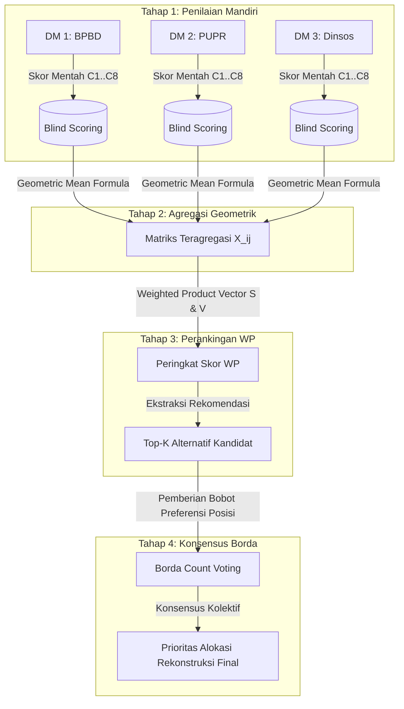
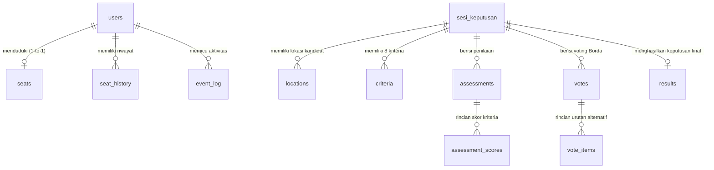

# GDSS Penentuan Lokasi Prioritas Rekonstruksi & Alokasi Bantuan Pascabencana
> **Enterprise-Grade Group Decision Support System (GDSS)** untuk Badan Penanggulangan Bencana Daerah (BPBD), Dinas Pekerjaan Umum (PUPR), dan Dinas Sosial.

[](https://www.djangoproject.com/)
[](https://www.python.org/)
[](https://www.postgresql.org/)
[](https://tailwindcss.com/)
[](https://cheatsheetseries.owasp.org/)
[-brightgreen?style=for-the-badge&logo=pytest&logoColor=white)](https://docs.pytest.org/)

---

## 📌 Ringkasan Eksekutif (Executive Summary)

Dalam mitigasi pascabencana, alokasi anggaran dan logistik rekonstruksi kerap dihadapkan pada friksi antar-instansi, subjektivitas penilaian sektoral, dan tuntutan transparansi publik. Sistem Pendukung Keputusan Kelompok (*Group Decision Support System* - GDSS) ini dirancang untuk memfasilitasi pengambilan keputusan kolaboratif, adil, dan objektif antara tiga pemangku kepentingan utama:
1. **Ketua Pelaksana BPBD** (*Lead Coordinator & Emergency Strategist*)
2. **Kepala Dinas Pekerjaan Umum & Penataan Ruang** (*Infrastructure & Technical Feasibility Expert*)
3. **Kepala Dinas Sosial** (*Vulnerable Population & Social Impact Expert*)

Sistem menggabungkan metode multi-kriteria berbasis sains keputusan (*Decision Science*) dengan arsitektur web modern yang menjamin integritas audit dan keamanan data tingkat tinggi.

---

## 🔬 Metodologi Pengambilan Keputusan (*Decision Science Engine*)



1. **Blind Multi-Expert Assessment**: Tiap *Decision Maker* (DM) melakukan *independent scoring* tanpa melihat penilaian DM lain hingga seluruh input terkunci.
2. **Agregasi Rata-rata Geometrik (*Geometric Mean*)**: Mereduksi deviasi ekstrem antar penilai guna menghasilkan matriks kompromi objektif:
   $$X_{ij} = \left(\prod_{k=1}^{m} x_{ijk}\right)^{\frac{1}{m}}$$
3. **Weighted Product (WP) Multi-Attribute Utility Theory**: Menilai preferensi alternatif lokasi berdasarkan normalisasi eksponensial bobot kriteria:
   $$S_i = \prod_{j=1}^{n} (X_{ij})^{w_j}, \quad V_i = \frac{S_i}{\sum_{k=1}^{p} S_k}$$
4. **Borda Count Voting Consensus**: Menjamin konsensus kelompok pada alokasi Top-$K$ lokasi dengan fungsi pilihan sosial (*social choice function*), memberikan bobot bertingkat pada urutan pilihan pembuat keputusan.

---

## 🛡️ Keamanan & Kepatuhan Arsitektur (*Defense-in-Depth*)

Sistem ini dibangun dengan kepatuhan ketat terhadap prinsip rekayasa perangkat lunak enterprise:

- **Single Active Session Enforcement (AC-06)**: Mencegah *credential sharing* atau sesi ganda. Login baru pada perangkat kedua seketika mendiskualifikasi sesi perangkat sebelumnya secara server-side.
- **Seat-Based Role-Based Access Control (AC-03)**: Otorisasi berbasis kedudukan fungsional (*Seat-bound identity*). Identitas dan hak akses diverifikasi secara *strictly backend-driven* dari token otentikasi sesi, menutup celah *parameter tampering*.
- **Append-Only Tamper-Resistant Audit Trail**: Seluruh aktivitas transaksional, login, perubahan data, dan percobaan akses ilegal (*ACCESS_DENIED*) dicatat pada tabel audit *immutable* tanpa hak akses `UPDATE` maupun `DELETE` di tingkat ORM maupun database.
- **Argon2 Password Hashing**: Standar *cryptographic hashing* pemenang Password Hashing Competition (PHC) dengan perlindungan terhadap serangan *GPU brute-force* dan *side-channel*.
- **Anti-Brute Force Protection**: Penguncian otomatis akun (*account lockout*) selama 15 menit setelah 5 kali kesalahan input kata sandi berturut-turut.
- **Anti-Slop UI Architecture**: Antarmuka responsif ramah operasional darurat (*mobile-first 360px to 1440px desktop*), mematuhi standar aksesibilitas WCAG AA dan dioptimalkan untuk performa tinggi tanpa *redundant assets*.

---

## 🏛️ Struktur Basis Data & ERD Inti



---

## 🚀 Panduan Instalasi & Pengujian

### 1. Prasyarat Sistem
- Python 3.12+ (disarankan Python 3.15)
- PostgreSQL 15+ (Opsional: SQLite bawaan untuk pengujian instan)
- Git CLI

### 2. Kloning & Pengaturan Lingkungan
```bash
# Clone repositori
git clone https://github.com/Louis-yoga/GDSS_Rekontruksi_Bencana.git
cd GDSS_Rekontruksi_Bencana

# Buat virtual environment
python -m venv .venv

# Aktivasi virtual environment
# Windows:
.\.venv\Scripts\activate
# Linux/macOS:
source .venv/bin/activate

# Install dependensi
pip install django argon2-cffi pytest pytest-django
```

### 3. Migrasi & Seeding Data Awal
```bash
# Jalankan migrasi skema basis data
python manage.py migrate

# Jalankan command seeding (menyiapkan 4 akun aktor, 3 kursi jabatan, dan data simulasi)
python manage.py seed_gdss
```

Akun bawaan hasil seeding:
| Kursi / Jabatan | Email | Peran | Kata Sandi Default |
| :--- | :--- | :--- | :--- |
| **Ketua Pelaksana BPBD** | `ketua@bpbd.go.id` | DM (Decision Maker) | `Bpbd@2026!` |
| **Kadis Pekerjaan Umum** | `kadis.pu@pupr.go.id` | DM (Decision Maker) | `Bpbd@2026!` |
| **Kadis Sosial** | `kadis.sosial@dinsos.go.id` | DM (Decision Maker) | `Bpbd@2026!` |
| **Administrator Teknis** | `admin@bpbd.go.id` | ADMIN | `Bpbd@2026!` |

### 4. Eksekusi Pengujian Otomatis (*Automated Testing Suite*)
```bash
pytest
```
*Hasil Verifikasi:*
```text
tests/test_auth_rbac.py::TestAuthentication ... PASSED
tests/test_auth_rbac.py::TestSingleSessionEnforcementAC06 ... PASSED
tests/test_auth_rbac.py::TestRBACAuthorizationAC03 ... PASSED
tests/test_foundation.py::TestFoundation ... PASSED
====================== 16 passed in 6.33s ======================
```

### 5. Menjalankan Server Pengembangan
```bash
python manage.py runserver
```
Akses sistem melalui peramban web di: `http://localhost:8000/`

---

## 👥 Pengembang & Hak Cipta

- **Lead Engineer / Author**: [Louis Yoga](https://github.com/Louis-yoga)
- **Lisensi**: MIT License — Terbuka untuk pengembangan institusional & akademik.
